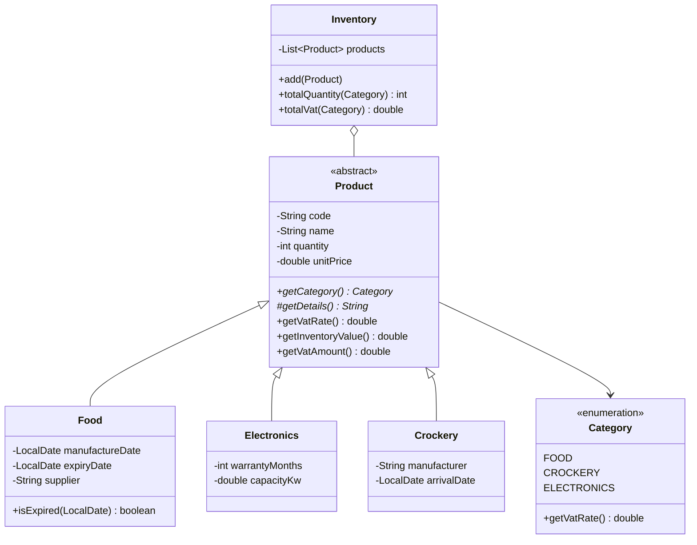

# Practice 2 — Supermarket inventory: design (Requirement 1)

Code: `src/main/java/com/tunna/training/practice2/`

## Classes

| Class | Kind | Role |
|---|---|---|
| `Product` | **abstract** | What every kind of goods has in common |
| `Food` | concrete, `extends Product` | Food |
| `Electronics` | concrete, `extends Product` | Electrical goods |
| `Crockery` | concrete, `extends Product` | Crockery |
| `Category` | enum | The 3 kinds of goods and their VAT rates |
| `Inventory` | concrete | Holds a list of `Product`s and produces the manager's report |
| `SupermarketApp` | concrete | Demo program (`main`) |

`Product` is abstract because there's no such thing as a "plain product": each item must be food, electronics or crockery.

## Attributes and methods

### `Product` (abstract)
- Attributes: `code`, `name`, `quantity` (>= 0), `unitPrice` (>= 0)
- Abstract methods: `getCategory()`, `getDetails()`
- Shared methods: getters/setters (with validation), `getVatRate()`, `getInventoryValue()` = quantity × unitPrice, `getVatAmount()` = value × VAT rate, `toString()`

### `Food`
- Attributes: `manufactureDate`, `expiryDate` (must be on or after `manufactureDate`), `supplier`
- Methods: `isExpired(today)`, overrides `getCategory()` → `FOOD`, `getDetails()`

### `Electronics`
- Attributes: `warrantyMonths` (>= 0), `capacityKw` (>= 0)
- Methods: overrides `getCategory()` → `ELECTRONICS`, `getDetails()`

### `Crockery`
- Attributes: `manufacturer`, `arrivalDate`
- Methods: overrides `getCategory()` → `CROCKERY`, `getDetails()`

### `Category` (enum)
- `FOOD` (VAT 5%), `CROCKERY` (VAT 10%), `ELECTRONICS` (VAT 10%)

### `Inventory`
- Attributes: `List<Product> products`
- Methods: `add(product)` (rejects duplicate codes), `getProducts()`, `totalQuantity(category)`, `totalVat(category)`, `quantityByCategory()`, `vatByCategory()`

## Relationships

- **Inheritance**: `Food`, `Electronics` and `Crockery` all `extends Product`. They reuse the shared attributes, the validation, and how VAT is calculated.
- **Polymorphism**: `Inventory` works only with `Product`. `getVatAmount()` and `toString()` call `getCategory()`/`getDetails()`, and Java runs the version from the actual subclass. Adding a new kind of goods means writing one subclass, with no changes to `Inventory`.
- **Aggregation**: `Inventory` holds many `Product`s.

## VAT
The VAT amount for a kind of goods = Σ (quantity × unit price × VAT rate) over the products of that kind in stock.
